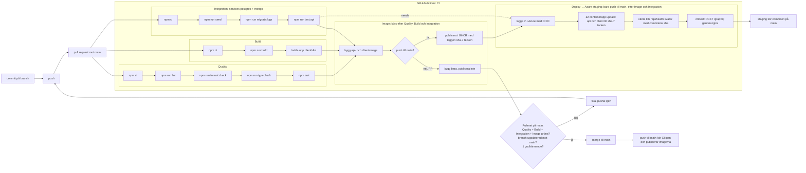

# Pipeline Docs

## Ruleset på main

Rulesetet heter `main` och ligger under _Settings → Rules → Rulesets_.

| Inställning | Värde |
| --- | --- |
| Enforcement status | **Active** |
| Target | Default branch (`main`) |
| Bypass list | Tom – reglerna gäller även admins |

Regler:

- **Restrict deletions** – `main` kan inte raderas.
- **Block force pushes** – ingen kan skriva om historiken på `main`.
- **Require a pull request before merging**
  - Minst **1** godkännande krävs, så ingen kan merga sin egen PR ensam.
  - Tillåtna merge-metoder: merge och squash.
- **Require status checks to pass**
  - Kräver: **`Quality`**, **`Build`**, **`Integration`** och **`Image`** från GitHub Actions.
    Namnen är jobbens `name:` i `.github/workflows/ci.yml`. `Integration` lades till i M5.
  - Kontrollerat 2026-10-27 med `gh api repos/utpost-team/utpost/rulesets/23657261`:

    ```
    enforcement=active bypass=0
    strict=true checks=Quality, Build, Integration, Image
    approvals=1
    ```

    På PR #71 visar `gh pr checks 71 --required` alla fyra som required och gröna.

  - **Require branches to be up to date before merging** är på – branchen måste
    vara uppdaterad mot `main` innan merge.

- **Deploy → Azure staging är inte en status check (M6).** Jobbet körs bara vid push till
  `main`, alltså efter merge. På en PR står det som *skipped*, och en required check som
  aldrig körs skulle blockera varje merge. Blir Deploy rött är `main` ändå korrekt – koden
  har passerat de fyra kraven – men staging kör fortfarande förra commiten. Kontrollerat
  igen 2026-11-03 med samma `gh api`-anrop: `checks=Quality, Build, Integration, Image`.

## CI flödesdiagram



På en PR hoppas Deploy över (`if: github.event_name == 'push'`). Deploy är inte med i rulesetet, se ovan.
## Vad varje steg fångar

| Steg | Jobb | Kommando | Fångar |
| --- | --- | --- | --- |
| Installera | Quality, Build | `npm ci` | Att `package-lock.json` inte stämmer med `package.json`, eller att ett beroende inte går att installera. Alla får exakt samma versioner som i lockfilen. |
| Lint | Quality | `npm run lint` (ESLint) | Kodfel som inte syns förrän appen körs: odefinierade variabler, oanvända variabler och importer, trasiga Vue-templates (`eslint-plugin-vue`) och vanliga misstag i testfiler (`@vitest/eslint-plugin`). |
| Format | Quality | `npm run format:check` (Prettier) | Kod som inte följer vår formatering (inga semikolon, enkla citattecken, max 100 tecken per rad). CI kör `--check`, inte `--write`. Den säger bara ja eller nej och ändrar ingen kod. |
| Typkontroll | Quality | `npm run typecheck` (först `codegen` i `client/`, sedan `vue-tsc` i `client/` och `tsc --noEmit` i `api/`) | Typfel mot API-kontraktet i `@utpost/shared`: fel fältnamn (`guide.lengthKm` istället för `length_km`), fält som kan vara `null` men används som om de alltid finns, och routes som svarar med något annat än sin `Response<...>`-typ. |
| Test | Quality | `npm test` (Vitest) | Att testerna går igenom. Just nu finns bara ett röktest som visar att pipelinen faktiskt kör tester. Riktiga tester kommer i M2. |
| Codegen (M5) | Quality | `npm run codegen --workspace=client`, första delen av `npm run typecheck` | Att klienten och API:et har glidit isär: en fråga i en vy ber om ett fält som inte finns i `api/src/graphql/schema.js` (`Cannot query field …`). Codegen skriver om `client/src/gql/` ur schemat, och `vue-tsc` säger sedan ifrån om en mall använder ett fält som frågan inte ber om. |
| Integrationstester (M5) | Integration | services Postgres + Mongo → `npm ci` · `npm run seed` · `npm run migrate:logs` · `npm run test:api` | Fel bakom vyerna, som klientens tester (de mockar `useQuery`) aldrig ser: resolvers och SQL mot en riktig databas, att migreringen tappar mätpunkter (`migrate:logs` avslutar med felkod), inloggningskravet på `createTour` – och N+1: regressionstestet kräver `extensions.databasfragor === 4` för `Turer`. Databaserna heter `localhost:5432` och `localhost:27017` i jobbet och är tomma tills seed och migrate:logs har körts. |
| Bygge | Build | `npm run build` (Vite) | Kod som inte går att bygga för produktion: importer som pekar på filer som inte finns, syntaxfel och komponenter som inte kompilerar. |
| Artefakt | Build | `upload-artifact` | Fångar inga fel, men sparar det byggda `client/dist` så att man kan ladda ner och titta på exakt det som byggdes. |
| Image | Image | `docker/build-push-action` (`api/Dockerfile`, `client/Dockerfile`) | Att Dockerfilerna faktiskt bygger: saknade filer i bygget, fel sökvägar i multi-stage-bygget och `npm ci` som bara fungerar på vår dator. På PR bygger jobbet utan att publicera. Vid push till `main` publiceras `…-api` och `…-client` i GHCR med taggen `sha-<7 tecken>`. Jobbet kör först när Quality och Build är gröna och är det enda som har `packages: write`. |
| Deploy (M6) | Deploy → Azure staging | `azure/login` (OIDC) · `az containerapp update` × 2 · `curl /api/health` i en loop · `curl /graphql` | Att imagen som testades faktiskt startar i molnet med molnets konfiguration: en image som inte går att hämta (privat paket i GHCR), nginx som inte startar (saknad `API_UPSTREAM`), ett API som inte når sina databaser eller inte kan seeda. Väntesteget godkänner först när `/api/health` svarar med just den här commitens sha *och* den sista revisionen är klar – att `az` tog emot beställningen räcker inte. Röktestet visar att nginx skickar `/graphql` vidare och att databasen har data. Körs bara vid push till `main` och har `needs: [image, integration]`, så kod med röda API-tester deployas aldrig. |

Lint, format, `npm test` och bygget körs mot `client/`. Typkontrollen täcker även `api/`, och Integration kör `api/`:s tester. `web/` (React-klienten) togs bort i M6, se nedan.

### `web/` borttagen (M6)

En klient byggs, testas och deployas: `client/`. Av de sju sidorna i `web/` fanns fem redan i `client/`, och två portades i M6: Profile (`ProfileView.vue`, `/profil`) och TourDetail (`TourDetailView.vue`, `/turer/:id`).

| `npm ci` i Quality | Paket | Tid | Körning |
| --- | --- | --- | --- |
| Före (main, `31c66a8`) | 825 | 51 s | [41624392478](https://github.com/utpost-team/utpost/actions/runs/41624392478/job/125877952378) |
| Efter (PR #76) | 806 | 51 s | [41625859789](https://github.com/utpost-team/utpost/actions/runs/41625859789/job/125882903064) |

19 paket färre, men ingen mätbar skillnad i tid. React, react-dom, react-router och Vite 5 var en liten del av de drygt 800 paketen. Resten är `client/`:s verktyg (codegen, Vitest, ESLint, vue-tsc) och `api/`, som installeras i samma `npm ci`. Det vi vann är att det inte längre ligger en andra klient i repot som installeras utan att testas.

## CI Tidsmätning

```bash
== Quality 13s
0s      Set up job
1s      Run actions/checkout@v4
1s      Run actions/setup-node@v4
6s      Run npm ci
1s      Run npm run lint
1s      Run npm run format:check
2s      Run npm test
0s      Post Run actions/setup-node@v4
0s      Post Run actions/checkout@v4
0s      Complete job
== Build 15s
1s      Set up job
0s      Run actions/checkout@v4
1s      Run actions/setup-node@v4
6s      Run npm ci
2s      Run npm run build
1s      Run actions/upload-artifact@v4
0s      Post Run actions/setup-node@v4
0s      Post Run actions/checkout@v4
0s      Complete job
```

### Integration (M5)

Första körningen, på PR #71 ([körning 40520539592](https://github.com/utpost-team/utpost/actions/runs/40520539592)):
**38 s** för hela jobbet. Mer än hälften är att starta databaserna; själva testerna tar under en sekund.

```bash
== Integration 38s (PR #71)
1s      Set up job
20s     Initialize containers
1s      Run actions/checkout@v4
1s      Run actions/setup-node@v4
7s      Run npm ci
1s      Run npm run seed
1s      Run npm run migrate:logs
1s      Run npm run test:api
0s      Post Run actions/setup-node@v4
1s      Post Run actions/checkout@v4
1s      Stop containers
0s      Complete job
```

På `main`, efter merge av #71 ([körning 40522832144](https://github.com/utpost-team/utpost/actions/runs/40522832144),
commit `e25079c`): **46 s**, alla fyra jobben gröna.

```bash
== Integration 46s (main, e25079c)
0s      Set up job
25s     Initialize containers
0s      Run actions/checkout@v4
5s      Run actions/setup-node@v4
7s      Run npm ci
1s      Run npm run seed
0s      Run npm run migrate:logs
2s      Run npm run test:api
0s      Post Run actions/setup-node@v4
0s      Post Run actions/checkout@v4
3s      Stop containers
0s      Complete job
```

| Jobb | PR #71 | `main` (`e25079c`) |
| --- | --- | --- |
| Quality | 41 s | 31 s |
| Build | 23 s | 21 s |
| **Integration** | **38 s** | **46 s** |
| Image | 31 s | 25 s |

Skillnaden i Integration är nästan bara containerstarten (20 s mot 25 s) och `setup-node` (cachen).
Integration körs parallellt med Quality och Build, så den gör inte PR:en mycket långsammare –
men Image väntar nu på den. På `main` var Integration sist klar av de tre, på PR #71 var det Quality.

### Deploy → Azure staging (M6)

Första körningen på `main`, efter merge av #78 ([körning 41639517274](https://github.com/utpost-team/utpost/actions/runs/41639517274),
commit `12f3155`): **alla fem jobben gröna**, Deploy **91 s**.
På PR #78 ([körning 41638789333](https://github.com/utpost-team/utpost/actions/runs/41638789333/job/125927256868))
står Deploy som **skipped** – de fyra andra gröna.

```bash
== Deploy → Azure staging 91s (main, 12f3155)
0s      Set up job
4s      Logga in i Azure med GitHubs identitet (OIDC)
50s     Byt image på api och client – exakt den här committen
34s     Vänta tills staging kör den här committen
0s      Röktest – GraphQL genom nginx-proxyn
1s      Post Logga in i Azure med GitHubs identitet (OIDC)
0s      Complete job
```

Ur loggen:

```
Försök 1/30: staging kör (inget svar ännu – appen väcks från noll?), klar revision utpost-team--sha-12f3155, väntar 10 s
✅ https://utpost-team.wonderfulstone-abf1c527.swedencentral.azurecontainerapps.io kör 12f3155beb077d36d4a0adea18af7d5c2c0fe492 (revision utpost-team--sha-12f3155)
✅ /graphql svarar via nginx, med data ur en seedad databas
```

Revisionen efter deployen: **`utpost-team--sha-12f3155`** (`az containerapp revision list` visar den som enda aktiva).

| Jobb | PR #78 | `main` (`12f3155`) |
| --- | --- | --- |
| Quality | 34 s | 31 s |
| Build | 18 s | 21 s |
| Integration | 40 s | 40 s |
| Image | 30 s | 30 s |
| **Deploy → Azure staging** | **skipped** ([jobb](https://github.com/utpost-team/utpost/actions/runs/41638789333/job/125927256868)) | **91 s** ([jobb](https://github.com/utpost-team/utpost/actions/runs/41639517274/job/125929752386)) |

Mer än halva tiden är de två `az containerapp update`-anropen (50 s, ett per container, och varje
anrop väntar tills Azure har skapat revisionen). Väntesteget tog 34 s: det första `curl` fick
inget svar medan den nya revisionen startade och seedade sina tomma databaser. Från merge till
att staging kör den nya commiten tar det alltså ungefär tre minuter (Quality/Build/Integration
~40 s, Image 30 s, Deploy 91 s).
